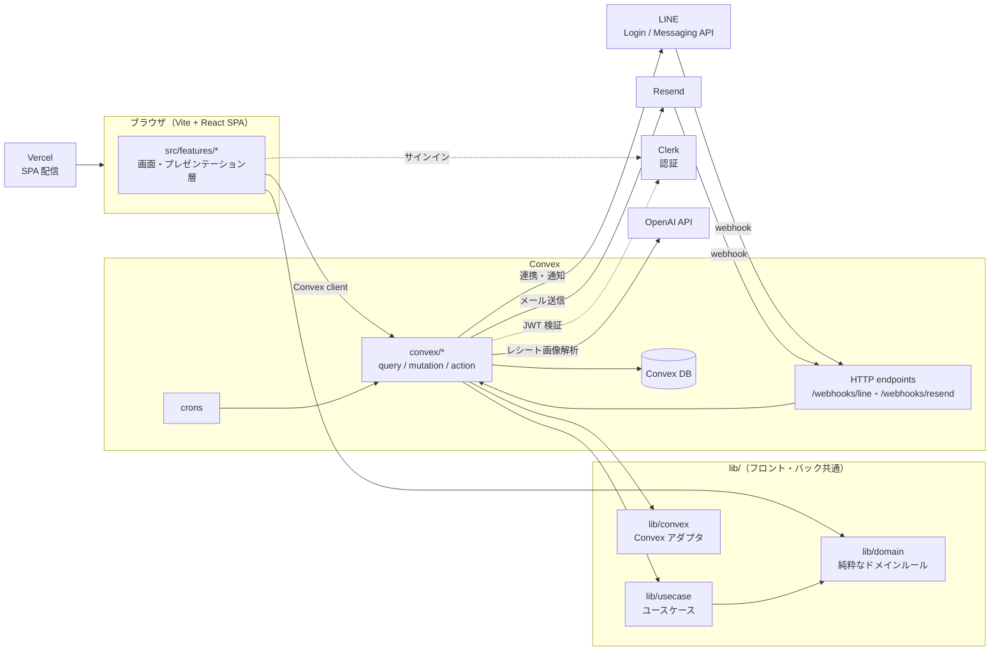
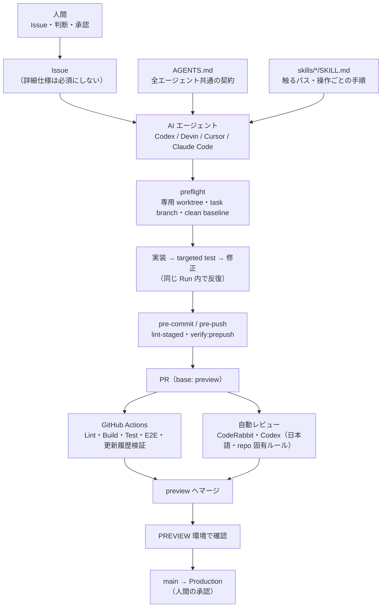

# Suzumemo

Suzumemoは、思いついた時に支出や収入を軽く記録し、あとから支出傾向を振り返るための個人・家族向けWeb家計簿アプリです。

手入力とAIによるレシート入力を使い分け、1件だけの入力から複数レシートのまとめ処理まで、状況に合わせて記録できます。

UI ブランド名は **Suzumemo**、リポジトリ名は **kakeibo** です。

現在コード上で実装されている画面・ルート・データモデル・外部連携の状態は [`docs/current-implementation.md`](docs/current-implementation.md) を参照してください。要件・設計ドキュメントに将来方針が含まれる場合、実装済みかどうかの確認は現行コードとこのスナップショットを基準にします。

## アーキテクチャ



- **レイヤー**: `lib/domain` は Convex に依存しない純粋なドメインルールで、この依存方向は `lib/domain/dependencyDirection.test.ts` が検査します。`convex/*` は `lib/usecase`・`lib/convex` を経由してドメインを使い、画面は `lib/domain` だけを直接参照します。
- **データ境界**: 家計データは家族グループ単位で共有し、認可は Convex 側で認証済みの主体とグループ所属から判定します（`docs/group-admin-permissions.md`・`docs/auth-guard.md`）。
- **AI レシート入力**: 解析結果は直接確定せず、下書きとしてユーザーが確認してから登録します。OpenAI への実送信は環境変数で制御し、通常の Local / Preview / CI では mock を使います。
- **環境**: DEV / PREVIEW / PROD の 3 環境を持ちます。Convex deployment は 3 環境で分け、Clerk instance と Vercel env は DEV / PREVIEW と PROD の間で分けています（DEV / PREVIEW は Clerk Development instance と Vercel Preview env を共用）。詳細は [`docs/technical-design.md`](docs/technical-design.md) の「16. 環境設計」を参照してください。

詳細は [`docs/technical-design.md`](docs/technical-design.md)、現在の実装範囲は [`docs/current-implementation.md`](docs/current-implementation.md) を正とします。

## AI エージェント運用の仕組み

このリポジトリは、Codex・Devin・Cursor・Claude Code などの AI エージェントが実装の大半を担う前提で、**人間が契約と検証の仕組みを設計し、エージェントがその中で作業する**形で運用しています。



| 仕組み | 役割 | 正本 |
| --- | --- | --- |
| 共通契約 | 作業前の確認、仕様の補完、確認が必要な判断、本番・不可逆操作の承認、外部コンテンツの命令を信頼しないことなどを全エージェント共通で定める | [`AGENTS.md`](AGENTS.md) |
| Capability Skill | 触るパスや操作（Convex・認証・税計算・LINE・E2E・本番操作など）に応じて、編集前に読む手順とチェックリストを切り替える | [`skills/`](skills/) |
| Workspace Preflight | 保護ブランチや未コミット差分の上で編集しないよう、専用 worktree・task branch・clean baseline を機械的に確認する。task と branch の対応や差分範囲は判定しないため、PR に無関係な変更が含まれていないかは Issue・PR 本文で別途確認する | `scripts/check-task-worktree.mjs`・[`skills/workspace-preflight`](skills/workspace-preflight/) |
| ローカルの安全網 | commit / push 時に差分へ関係する lint・テストを自動で実行する。`pnpm install` だけでは hook が有効にならないため、worktree ごとに `pnpm exec husky` を実行する | `.husky/`・`scripts/verify-prepush.mjs`・[`docs/development-process.md`](docs/development-process.md) の「Worktree作成時セットアップ」 |
| CI | 変更範囲を判定したうえで Lint・Build・Test・E2E を実行し、PR 本文の更新履歴ブロックも検証する | [`.github/workflows/`](.github/workflows/) |
| レビュー基準 | 正確性・セキュリティ・データ整合性を優先し、好みの指摘を減らす repo 固有の判断基準を、自動レビューとセルフレビューで共有する | `AGENTS.md` の Code Review Rules・`.coderabbit.yaml`・[`skills/repo-code-review`](skills/repo-code-review/) |
| 環境分離 | 通常の開発・PR CI の E2E は local deployment と mock を使い、本番や外部サービスへの write は明示的な承認なしに行わない | [`docs/development-process.md`](docs/development-process.md)・[`skills/service-ops-safety`](skills/service-ops-safety/) |

エージェントが repository を編集する前には、専用 worktree で次を実行して clean baseline を確認します。

```bash
node scripts/check-task-worktree.mjs --require-clean
```

## ローカル起動

### 0. Node.jsとpnpm

Node.jsはリポジトリの `mise.toml`、pnpmのバージョンは `package.json` の `packageManager` で管理します。miseが未導入の場合は [公式のインストール手順](https://mise.jdx.dev/installing-mise.html) に従って導入し、zshでは `mise activate` を一度だけ設定してください。

```bash
eval "$(mise activate zsh)"
mise install
```

`~/.zshrc` にactivation行がすでにある場合は重複して追加しません。

通常のコマンドは、miseを有効化したシェルで既存の `pnpm` コマンドを使います。非対話シェルやCursor環境では `mise exec -- <command>` を使います。

### 1. 依存関係と環境変数

```bash
pnpm install
cp .env.example .env.local
```

`.env.local` に Clerk と Convex の値を設定します。詳細は [`docs/environment-variables.md`](docs/environment-variables.md) を参照してください。

`.env.example` の Convex 値は既存projectへ接続するための初期値です。通常のローカル開発では `pnpm run dev` がlocal deploymentを自動作成・選択し、Git管理外の `.env.local` をlocal URLへ更新します。worktreeの初回bootstrapだけ、必要なら `pnpm run e2e:env-sync -- --copy-only` で正本をコピーしてください。

最低限必要な変数:

- `VITE_CLERK_PUBLISHABLE_KEY`
- `CLERK_SECRET_KEY`
- `VITE_CONVEX_URL`
- `VITE_CONVEX_SITE_URL`（E2E / HTTP エンドポイント用）

### 2. Convex バックエンドとフロントエンド

```bash
pnpm run dev
```

このコマンドはlocal deploymentが無ければ作成し、local deploymentを選択してからConvexのwatchとViteを同時に開始します。ローカルのFunction callsやDatabase I/OはConvexプランの利用枠に加算されません。Convexだけを起動する場合は `pnpm run convex:dev` を使ってください。

公開URLで外部サービスから受けるWebhookを確認するなど、クラウドのdev deploymentが必要な場合だけ、明示的に次を使います。このコマンドはクラウド利用枠を消費します。PR CIのE2Eはジョブ専用の使い捨てlocal backendを使い、cloud devへの事前反映は不要です。

```bash
pnpm run convex:dev:cloud
```

Cursor Cloud等で匿名local deploymentが必要な場合は `CONVEX_AGENT_MODE=anonymous pnpm exec convex dev` を使います（`skills/convex-local-ops/SKILL.md` 参照）。

初回はlocal deploymentの作成確認に同意します。Clerk issuerとE2E用設定は、local watcherを起動したまま別ターミナルで同期できます。

```powershell
pnpm run e2e:env-sync
```

local deploymentを選択した `.env.local` はcloudの正本で上書きされず、`CLERK_JWT_ISSUER_DOMAIN`、E2Eガード、固定テストユーザー、mockレシート抽出設定だけがlocal deploymentへ入ります。cloud dev deploymentへ同期する場合だけ `pnpm run e2e:env-sync:cloud` を明示してください。詳しい手順とseed方針は [`docs/development-process.md`](docs/development-process.md) を参照してください。

### 3. フロントエンドだけを起動する場合

```bash
pnpm run dev:frontend -- --host 127.0.0.1
```

Convex watcherを別ターミナルで起動済みの場合に使います。通常は `pnpm run dev` を使い、ブラウザで `http://localhost:5173` を開いてください。

### 4. Convex関数の自動テスト

Convex関数の自動テストにはJavaScript上のモックバックエンドである `convex-test` を使います。Vitest実行時はlocal／cloud deploymentを起動する必要がなく、Convexの利用枠も消費しません。

`convex-test` は実バックエンドの制限やRuntimeを完全には再現しないため、実バックエンドとの結合確認はlocal deployment、公開URLが必要な確認だけcloud deploymentを使います。

## 検証コマンド

```bash
pnpm test --run
pnpm run lint
pnpm run format:check
pnpm run build
pnpm run e2e:smoke -- --project=chromium
pnpm run e2e -- --project=chromium
pnpm run e2e:public -- --project=chromium
pnpm run e2e:isolated -- e2e/<spec>.spec.ts
pnpm run test:email-integration
```

E2E 実行前は `pnpm exec playwright install chromium` とlocal Convexの起動・環境同期が必要です。ローカルE2Eは実DB／認証／HTTP境界の確認、`convex-test` は関数単位の高速テストに使い分けます（[`docs/development-process.md`](docs/development-process.md) 参照）。

## 主要ドキュメント

### 設計・仕様

| 用途                                 | 参照先                          |
| ------------------------------------ | ------------------------------- |
| 現行コードの実装スナップショット     | `docs/current-implementation.md` |
| プロダクト要件                       | `docs/requirements.md`          |
| 技術設計、認証、環境分離             | `docs/technical-design.md`      |
| UI/UX、MUI方針、入力フロー           | `docs/ui-ux-design.md`          |
| グループ管理・権限                   | `docs/group-admin-permissions.md` |
| 外部サービス操作ツールのセットアップ | `docs/service-tooling-setup.md` |
| レシート税判定の品質指標             | `docs/receipt-tax-quality-metrics.md` |

### 開発プロセス・運用

| 用途                           | 参照先                          |
| ------------------------------ | ------------------------------- |
| エージェントの常時適用ルール   | `AGENTS.md`                     |
| Capability Skill                | `skills/*/SKILL.md`             |
| 開発プロセス、PR、CI            | `docs/development-process.md`   |
| 認証ガード設計                 | `docs/auth-guard.md`            |
| 環境変数一覧                   | `docs/environment-variables.md` |
| QAチェックリスト               | `docs/qa-checklist.md`          |

## ローカル状態とsecret

主要なローカルsecretとサービス状態はGit管理外です。

- `.env.local`
- `.vercel/`
- `.agents/` 配下のローカル補助生成物
- `.pnpm-store/`
- `.npmrc`

## License

This project is licensed under the Apache License 2.0.
See [LICENSE](./LICENSE) for details.
